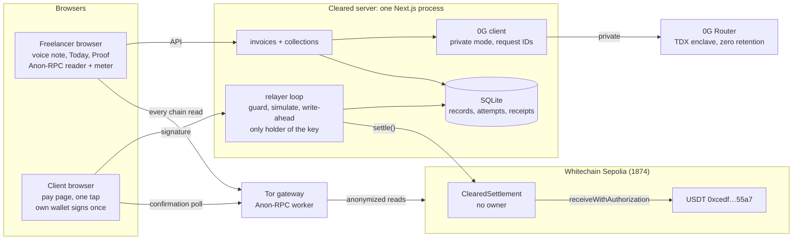
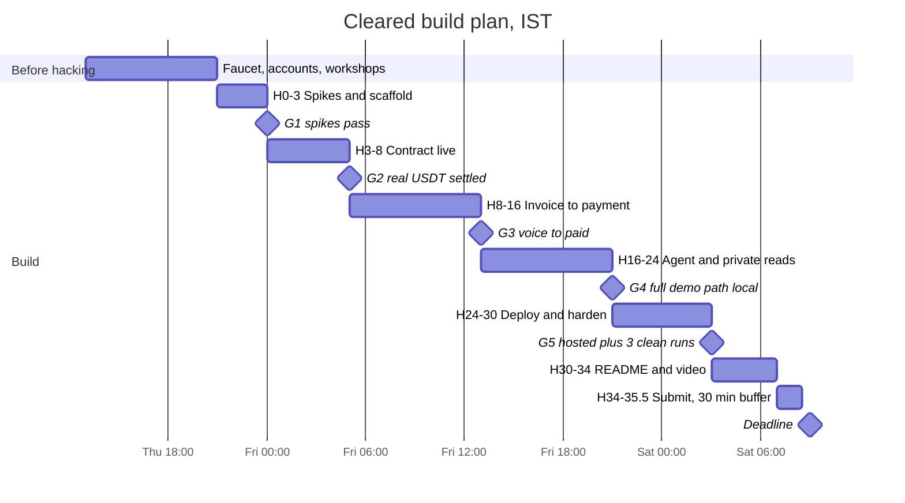

# Cleared: build plan for ETHGlobal Mumbai

Nov 5, 2026

## Summary

Build Cleared, an app that stops contractors chasing late payments. It writes an invoice from a voice note, collects USDT from a payment link, and has a private AI follow up with clients who haven't paid. It enters three ETHGlobal Mumbai sponsor tracks where competition was lowest at comparable past events.

| Sponsor track | Prize (1st / 2nd / 3rd) | What Cleared uses it for | Past entries per prize spot |
| --- | --- | --- | --- |
| [0G: Build with 0G Private Computer](https://ethglobal.com/events/mumbai/prizes#0g) | $2,500 / $1,500 / $1,000 | Voice transcription, invoice drafting and the collections agent, all run in a TEE enclave | about 5 (New Delhi 2025) |
| [EF: Best Use of Anon-RPC](https://ethglobal.com/events/mumbai/prizes#ethereum-foundation) | $2,500 / $1,500 / $1,000 | Every chain read the app makes goes through Tor | about 4 (New Delhi 2025) |
| [Whitechain: Operate, Stablecoin Payments for Business](https://ethglobal.com/events/mumbai/prizes#whitechain) | $2,500 / $1,500 / $1,000 | Payment links, invoices and reminders, a drop-in Pay button, and an accountant export | no past entries (first ETHGlobal event) |

**The user.** A contractor anywhere in the world who already gets paid in stablecoins, such as a designer in Buenos Aires working for web3 startups. The problem Cleared solves is late payment. Chasing clients is slow and awkward, and it's the one pain the research confirmed.

**The client.** A crypto-native company that already holds USDT. The client pays from their own wallet.

**The one-line pitch.** "Stop chasing late payments. Say what you did, Cleared sends the invoice, collects the USDT, and follows up with anyone who's late."

**What the privacy features are for.** Private AI and Tor reads earn the 0G and EF tracks. They aren't a demand the research found, so they support the pitch and don't lead it.

**Best case from sponsors.** About $7,500 if all three tracks place first. The [finalist prize](https://ethglobal.com/events/mumbai/prizes#finalist-prizes) is separate. It pays $250 for a solo hacker with no travel money, $250 per person plus $250 travel for 2 people, and $1,000 per person plus $500 travel for 3 to 5 people.

## End-user flows

There are two people in every demo. Lucia is a freelance designer in Buenos Aires. Acme is a web3 startup that pays its contractors in USDT, and its finance lead is the client.

**Lucia creates an invoice (about 30 seconds).**

1. Lucia signs in. With the 0G iAI sign-in, her daily 0G credits show in the header.
2. She taps the mic and says: "Invoice Acme, three logo drafts, six hundred dollars, due in seven days."
3. Cleared transcribes the note and drafts the invoice privately: client, line items, amount in USDT, due date. A badge shows "Private AI, TEE verified" with the 0G request ID.
4. She edits a field if needed and taps Send. Cleared gives her a payment link to send to Acme.

**The client pays (about 20 seconds).**

1. The client opens the link. They see the invoice, the amount and a "Pay 600 USDT" button.
2. They connect their wallet and sign once. The signature costs them no gas.
3. Cleared's relayer submits the payment and pays the gas. The page shows "Paid" with an explorer link within a few seconds.

**A business adds Cleared to its own site (the drop-in).**

1. A developer creates a payment link with one API call, or adds the Cleared Pay button script to a page.
2. Their customer pays through the same pay page.
3. The developer reads the payment status from the API. The whole integration is about 20 lines.

**Lucia's next morning (the reason to return).**

1. Lucia opens Cleared and sees "Who owes you": 1 paid today, 2 overdue, total outstanding.
2. For each overdue invoice, the collections agent has drafted a reminder. The tone gets firmer the later the invoice is: a friendly nudge under 7 days, a firm note from 7 days, a final notice from 14 days.
3. She pastes a client's reply ("we'll pay Friday"). The agent reads it, marks the invoice "promised Fri", and pauses reminders until then.
4. She approves each reminder before it goes out. Nothing is sent without her tap.
5. At month end she downloads a CSV for her accountant, with each invoice, fee, net amount and explorer link.
6. Her dashboard totals come from the chain, read through Tor. A small "Private reads" indicator shows the share of reads that went through Anon-RPC.

## Track requirements matrix

Each sponsor rule below has a feature that meets it, a demo moment that shows it, and the file that proves it. Rules come from the [Mumbai prizes page](https://ethglobal.com/events/mumbai/prizes), read on 2026-11-05.

| Track | Rule | Feature that meets it | Shown in the demo | Proof in the repo |
| --- | --- | --- | --- | --- |
| 0G | AI on 0G is the product, not a chat wrapper | Voice-to-invoice plus the collections agent. Without AI there's no invoice and no chasing | 0:20 voice note, 1:50 morning view | `README.md` "What breaks without 0G" |
| 0G | Inference in the main flow, with request IDs | Every AI call stores `request_id` and `tee_verified` on the invoice or reminder | Badge on the invoice | `ai_calls` table, `/proof` page |
| 0G | Reason to come back tomorrow | Daily "Who owes you" view and reminder drafts | 1:50 | Demo video |
| 0G | One sentence on what breaks without 0G | "Without 0G, client names, rates and voice notes go to an AI company in plaintext. With 0G they stay in a TDX enclave and each result carries a signed request ID." | Closing slide | `README.md` |
| 0G | iAI bonus: sign in with 0G, credits drop with use | 0G Privy sign-in. AI calls run on the user's credits | Header credit counter drops after the voice note | Demo on `localhost:3000` |
| 0G | Repo, setup steps, video under 3 minutes, live link, contacts | Public repo, hosted live link plus localhost demo | Whole video | `README.md` |
| EF | RPC reads go through Anon-RPC by default | One chain client for the browser, built on the Anon-RPC worker's `fetch`. No other read path exists | "Private reads 100%" indicator | `apps/web/lib/chain.ts` |
| EF | Share of traffic, disclosed exceptions | The Sepolia bootstrap read and relayer writes are disclosed in the README | Indicator plus one README line | `README.md` "Anon-RPC coverage" |
| EF | Works end to end, good UX, could ship | Loading state while Tor connects, a fallback RPC that still goes through Tor | Dashboard loads with a "Connecting privately" state | Demo video |
| Whitechain | Everything a business needs to get paid in USDT | Invoices, payment links, due dates and reminders | 0:55 client pays, 2:20 reminder | Demo video |
| Whitechain | Drop-in piece a separate demo app adds in about 20 lines | Payment link API and `pay.js` button, used by `examples/shop/` | 1:30 the demo shop with the Pay button | `examples/shop/` |
| Whitechain | Show the merchant and the paying customer | Lucia's dashboard and the client pay page | Both on screen | Demo video |
| Whitechain | Extra credit: go past the first payment | Accountant CSV export with fee, net amount and explorer link | 2:35 CSV download | `/api/invoices/export` |
| Whitechain | Contract deployed and verified on chain 1874 | `ClearedSettlement.sol` | Explorer link on screen | `README.md` contract address |
| Whitechain | At least 1 payment in official USDT `0xcedf…55a7` in the main flow | Every invoice settles in that token only | Explorer tx | `README.md` explorer link |
| Whitechain | README line on why onchain stablecoin settlement | "A contractor abroad gets dollars in minutes without a bank in the middle, and the payment itself is a receipt anyone can verify." | Closing slide | `README.md` |
| Whitechain | Steady commits, README setup, architecture, limitations, 2–4 minute video showing each party, feedback file | Commit at every gate in section 9 | Video shows Lucia and the client | `WHITECHAIN_FEEDBACK.md` |

The 0G video limit is under 3 minutes and Whitechain's is 2 to 4 minutes, so one video of 2:50 meets both.

## Architecture

Cleared is one server process, one SQLite file and one contract. Browsers read the chain only through Tor. The server writes to the chain only through the relayer, and the relayer can only call `settle()`.



**Trust boundaries.**

- **Browser to server.** zod parses every request at the route handler. Inside, the code trusts domain types. The pay request carries only a `PayToken`, the payer address, the validity window and a signature. Payee and amount always come from the database.
- **Server to 0G.** The 0G key never leaves the server. Every response is parsed into `Traced<T>` before any other code reads it. Each `ai_calls` row also stores its `invoice_id`, so the invoice page shows its own request IDs. A response without `x_0g_trace.request_id` counts as a failure.
- **Server to chain.** Only `src/server/relayer/` holds `RELAYER_PRIVATE_KEY`, and it only encodes `settle()`. Its traffic is the one disclosed exception to Anon-RPC.
- **Browser to chain.** Only `src/client/chain-reader.ts` can create a chain client in the browser, and it always goes through the Anon-RPC worker.
- **Chain.** `ClearedSettlement` has no owner. The client's signature binds the invoice, payee and amount, so nothing on the server can redirect money.

**Data flow for one invoice.** Voice note, then `POST /api/invoices/voice`, then 0G transcription and drafting, then an `invoices` row (`draft`). Send freezes the terms (`open`) and creates the `PayToken` link. The client signs, then `POST /api/pay/[token]`, then a `payment_attempts` row. The relayer loop simulates and broadcasts `settle()`, the tx confirms, and the attempt becomes `confirmed`. The freelancer's browser reads `settlements(id)` over Tor and shows "verified privately on-chain".

## Data model and types

An invoice's payment status is never stored. The database stores only what the freelancer wrote. "Paid" is derived from chain evidence, so the app can never say "paid" without a settled transaction behind it.

**Stored invoice kinds.** `draft`, `open` and `void`. Terms (payee, amount, line items) freeze when the invoice is sent, because they're signed into the payment.

**Derived invoice states.** These are computed on every read by one pure function, `deriveState(record, attempts, now)`:

| Derived state | Rule |
| --- | --- |
| `draft` | Stored kind is `draft` |
| `open` | Sent, not yet due, no live payment attempt |
| `overdue` | Sent, past the due date (or past a promised date), no live payment attempt |
| `promised` | Client promised a date that hasn't passed yet. Reminders pause |
| `paying` | A payment attempt is `queued` or `broadcast` |
| `paid` | An attempt is `confirmed`, which is only written from a success receipt or a `settlements(id)` read on chain |
| `void` | Stored kind is `void` |

**Payment attempt states.** Each attempt is a row the relayer owns. Allowed moves: `queued` to `broadcast`, `failed` or `expired`. `broadcast` to `broadcast` (a fee bump), `confirmed`, `failed` or `expired`. `confirmed`, `failed` and `expired` are final. A database unique index allows only one live attempt (`queued`, `broadcast` or `confirmed`) per invoice.

**Core types** (`src/domain/`, pure TypeScript, no I/O):

```ts
type Brand<T, B extends string> = T & { readonly __brand: B };
type InvoiceId   = Brand<`0x${string}`, 'InvoiceId'>;   // bytes32, also the on-chain key
type PayToken    = Brand<string, 'PayToken'>;           // secret in the pay link, never on chain
type Address     = Brand<`0x${string}`, 'Address'>;
type UsdtAtoms   = Brand<bigint, 'UsdtAtoms'>;          // 6 decimals, bigint only
type ZgRequestId = Brand<string, 'ZgRequestId'>;        // 0G x_0g_trace.request_id

type InvoiceRecord =
  | { kind: 'draft'; id: InvoiceId; client: Client; items: LineItem[]; dueAt: string }
  | { kind: 'open';  id: InvoiceId; client: Client; items: LineItem[]; dueAt: string;
      payee: Address; amount: UsdtAtoms; token: PayToken; sentAt: string }
  | { kind: 'void';  id: InvoiceId; voidedAt: string };

// Every AI output carries its 0G receipt. trustMode is a literal, so a non-private result can't exist.
type ZgReceipt = { requestId: ZgRequestId; provider: string; model: string;
                   trustMode: 'private'; teeVerified: boolean | 'not_reported'; at: string };
type Traced<T> = { value: T; receipt: ZgReceipt };
type AiResult<T> = { kind: 'ok' } & Traced<T>
  | { kind: 'unavailable'; reason: 'no_private_provider' | 'rate_limited' | 'network' | 'bad_output' };

type Tier = 'friendly' | 'firm' | 'final';
const tierFor = (daysLate: number): Tier => daysLate < 7 ? 'friendly' : daysLate < 14 ? 'firm' : 'final';

type ReplyIntent =
  | { kind: 'promised'; date: string } | { kind: 'asks_extension'; date: string }
  | { kind: 'disputed'; reason: string } | { kind: 'claims_paid' } | { kind: 'unclear' };
```

Two IDs per invoice on purpose. `InvoiceId` appears in the public `InvoiceSettled` event. If the pay link used it, anyone reading the chain could open the pay page and see the client's name and line items. The pay link uses the secret `PayToken` instead.

The tone tier and the escalation timing are code. The AI only writes the words for the tier the code picked. A client reply that "claims paid" never marks an invoice paid. The app checks the chain and shows what it found.

**SQLite tables** (`src/server/db/schema.ts`, Drizzle):

| Table | Key columns | Owner (only writer) |
| --- | --- | --- |
| `users` | `id`, `privy_id`, `payee_address`, `display_name` | auth |
| `clients` | `id`, `owner_id`, `name`, `email`, `whatsapp`, `lang` (`en` or `es`) | invoices |
| `invoices` | `id` (bytes32), `owner_id`, `kind`, `token` (stored as the sha256 of the link secret, unique), `client_id`, `items_json`, `payee`, `amount_atoms`, `due_at`, `transcript`, `sent_at` | invoices |
| `payment_attempts` | `id`, `invoice_id`, `state`, `payer`, `value_atoms`, `valid_after`, `valid_before`, `nonce`, `signature`, `raw_tx`, `tx_hash`, `tx_nonce`, `tries`, `failure` | relayer |
| `ai_calls` | `request_id`, `user_id`, `kind`, `model`, `provider`, `tee_verified`, `zg_res_key`, `billing_json`, `ok`, `latency_ms` | ai |
| `collection_drafts` | `id`, `invoice_id`, `tier`, `channel`, `subject`, `body`, `lang`, `state` (`drafted`, `approved`, `sent`), `request_id` | collections |
| `collection_notes` | `invoice_id`, `promised_date`, `disputed`, `last_contact_at` | collections |
| `collection_plans` | `user_id`, `local_date`, `plan_json` (daily cache, so a reload doesn't re-bill 0G) | collections |
| `gas_ledger` | `tx_hash`, `gas_used`, `fee_wei`, `day` | relayer |
| `rpc_meter` | `source`, `day`, `count` | relayer |

## Integrations

All three integrations were checked against their docs or the live chain on 2026-11-05. Each one sits behind a single module, so the rest of the app never sees a wire format.

### 0G Private Computer (`src/server/ai/zerog.ts`)

- **Endpoint.** `https://router-api.0g.ai/v1`, OpenAI-compatible. Auth is `Authorization: Bearer <key>`, server-side only ([quickstart](https://docs.0g.ai/developer-hub/building-on-0g/compute-network/router/quickstart)).
- **Private mode.** Every request sends `X-0G-Provider-Trust-Mode: private`. That routes only to TeeML providers (Intel TDX with TEE GPUs, zero retention). If none is available the router returns 503 `no_provider_for_trust_mode` and never falls back silently ([privacy](https://docs.0g.ai/developer-hub/building-on-0g/compute-network/router/privacy)).
- **Proof.** Every response has `x_0g_trace` with `request_id`, `provider` and `billing`. Sending `verify_tee: true` (on multipart, `?verify_tee=true`) adds `tee_verified`. The `ZG-Res-Key` response header is stored too, for independent checking with the SDK's `processResponse` ([verifiable execution](https://docs.0g.ai/developer-hub/building-on-0g/compute-network/router/features/verifiable-execution)).
- **Models.** `whisper-large-v3` for voice ([audio](https://docs.0g.ai/developer-hub/building-on-0g/compute-network/router/features/audio)). `glm-5.3` for drafting, reminders and reply reading. `0gm-1.0-35b-a3b` is the backup chat model and also reads images. Qwen vision and omni are excluded because they are TeeTLS, not private.
- **Output parsing.** `response_format: { type: 'json_object' }`, then a zod schema. On a schema failure there's one repair retry, then `bad_output`. The model never computes totals. It returns quantities and unit prices, and code sums them.

| Function | 0G call | Input | Output |
| --- | --- | --- | --- |
| `draftFromVoice` | `POST /audio/transcriptions?verify_tee=true` (multipart, `model=whisper-large-v3`), then `POST /chat/completions` (`glm-5.3`) | Voice note (webm/opus), saved clients, today's date | Client, line items (description, qty, unit price), due in days, note |
| `planToday` | One `POST /chat/completions` per day, cached in `collection_plans` | Each overdue or due-soon invoice with its tier, days late, language and notes | One reminder draft (subject, body) per invoice |
| `readReply` | `POST /chat/completions` | Pasted reply, invoice summary, today's date | `ReplyIntent`, with relative dates like "Friday" resolved to an ISO date |

**When private Whisper is down.** The voice screen says "Private transcription is unavailable right now, type your invoice instead." The typed text goes through the same private `glm-5.3` call, so the request ID requirement still holds. Nothing is faked.

**iAI sign-in bonus.** The 0G Privy app ID arrives at the event and only works on `localhost:3000`. With `AUTH_MODE=privy`, the header shows the user's 0G credit balance and it drops after each AI call. How the router bills a signed-in user's credits gets confirmed at the 0G sponsor booth in hour 0. Until then the app shows credits used, summed from `ai_calls.billing_json`.

### Anon-RPC (`src/client/chain-reader.ts`)

- **How it works.** `AnonRpcWorker` gives the browser an anonymized `fetch` that reaches any HTTPS RPC, so chain 1874 needs no new network support ([wallet guide](https://ethereum.github.io/anon-rpc/wallets/), [repo](https://github.com/ethereum/anon-rpc)).
- **Wiring.**

```ts
const worker = new AnonRpcWorker({ address: TOR_JS_SPECIFIER, config: { gateways },
  preExisting: { rpcProvider: mainnetBootstrapProvider } });
const client = createPublicClient({ chain: whitechainSepolia,
  transport: http('https://rpc.testnet.whitechain.io',
    { fetchFn: (u, i) => { meter.private++; return worker.fetch(u, i); } }) });
// If viem rejects fetchFn: custom({ request }) that posts the JSON-RPC body through worker.fetch.
```

- **RPC choice.** Whitechain's docs say their own endpoints are the only official public RPCs for chain 1874, so `rpc.testnet.whitechain.io` is primary. Ankr's `rpc.ankr.com/whitechain_testnet` answered during research and is the second entry in viem's `fallback()`. Both go through the worker.
- **What goes through it.** Every read the browser makes: the freelancer dashboard, the "verified privately on-chain" badge, and the client's confirmation poll. Reads are batched into one Multicall3 `aggregate3` call per screen. The pay button needs no chain read, so Tor never slows down paying.
- **Disclosed exceptions** (README "Anon-RPC coverage"). The one bootstrap read that resolves the Tor specifier on mainnet. The relayer's own server traffic (simulate, broadcast, receipts), which is Cleared's IP and reveals no user. The client's wallet extension, which uses its own RPC outside the app.
- **Boot and failure.** The worker starts on first page load. While it connects, the dashboard shows database data labeled "verifying privately". If Tor fails, the state turns `degraded` with an explicit "Read directly (not private)" button. The meter counts any direct read. There's no silent fallback.

### Whitechain USDT payments (`src/chain/eip3009.ts`)

- **Token.** Official USDT `0xcedfB56113143d55b2358b8CFbB0dEB5Ad2f55a7` is a proxy to TetherTokenV2, verified on the explorer. It supports `transferWithAuthorization`, `receiveWithAuthorization`, `cancelAuthorization`, `authorizationState` and `permit` (selectors read from bytecode).
- **Signing domain.** `{ name: 'Tether USD', version: '1', chainId: 1874, verifyingContract: 0xcedf…55a7 }`, hardcoded because `eip712Domain()` reverts. It was confirmed by matching the on-chain `DOMAIN_SEPARATOR`.
- **What the client signs.** One EIP-712 `ReceiveWithAuthorization` with `to` set to Cleared's settlement contract, `value` set to the invoice amount, `validBefore` set to now plus 1 hour, and `nonce` set to `settleNonce(...)` (section 7). The client signs it in their own wallet through `window.ethereum`, and it costs them no gas. The pay page asks the wallet to add chain 1874 first with `wallet_addEthereumChain`.
- **Proof it works.** A relayer-paid EIP-3009 transfer already succeeded on this token: tx `0x23c28fd3557b1125f705c4499218327b9d894e715ac4d8e4ba8bdb7eee29d376`, 84,429 gas.
- **Network.** RPC `https://rpc.testnet.whitechain.io`, explorer `https://explorer.testnet.whitechain.io` (Blockscout). The EVM version is Prague.

## Contract and relayer security

The relayer can delay a payment or pay its gas, and nothing else. It can't redirect money, replay a payment or settle an invoice twice. The client's one signature commits to the invoice, the freelancer and the amount, and the settlement contract has no owner.

### `contracts/src/ClearedSettlement.sol`

This is a flat single file with no imports, no owner, no proxy and no admin function. Build settings are solc `0.8.24`, `evm_version = prague`, optimizer 200 runs and `bytecode_hash = none`, so the explorer's recompile matches.

```solidity
// SPDX-License-Identifier: MIT
pragma solidity 0.8.24;

interface IUSDT3009 {
    function receiveWithAuthorization(address from, address to, uint256 value, uint256 validAfter,
        uint256 validBefore, bytes32 nonce, uint8 v, bytes32 r, bytes32 s) external;
    function authorizationState(address authorizer, bytes32 nonce) external view returns (bool);
}

contract ClearedSettlement {
    IUSDT3009 public immutable USDT;                 // 0xcedfB56113143d55b2358b8CFbB0dEB5Ad2f55a7
    address   public immutable TREASURY;             // receives fees; fees buy WBT for the relayer
    uint256   public constant FEE_BPS = 50;          // 0.5%
    uint256   public constant FEE_CAP = 2_000_000;   // 2 USDT (6 decimals)
    uint256   public constant MIN_VALUE = 5_000_000; // 5 USDT, so every fee covers its own gas

    struct Settlement { address payer; address payee; uint128 value; uint64 paidAt; }
    mapping(bytes32 invoiceId => Settlement) public settlements;

    event InvoiceSettled(bytes32 indexed invoiceId, address indexed payee, address indexed payer,
                         uint256 value, uint256 fee);
    error AlreadySettled(bytes32 invoiceId);
    error BelowMinimum();
    error TransferFailed();

    constructor(IUSDT3009 usdt, address treasury) { USDT = usdt; TREASURY = treasury; }

    /// The EIP-3009 nonce the payer signs. Binds version, chain, this contract, invoice, payee, amount.
    function nonceFor(bytes32 invoiceId, address payee, uint256 value) public view returns (bytes32) {
        return keccak256(abi.encode(bytes32("CLEARED_SETTLE_V1"), block.chainid, address(this),
                                    invoiceId, payee, value));
    }

    /// Permissionless: anyone may pay the gas. Only the payer's signed USDT moves, only to the signed payee.
    function settle(bytes32 invoiceId, address payer, address payee, uint256 value,
                    uint256 validAfter, uint256 validBefore, uint8 v, bytes32 r, bytes32 s) external {
        if (settlements[invoiceId].paidAt != 0) revert AlreadySettled(invoiceId);
        if (value < MIN_VALUE) revert BelowMinimum();
        settlements[invoiceId] = Settlement(payer, payee, uint128(value), uint64(block.timestamp));
        USDT.receiveWithAuthorization(payer, address(this), value, validAfter, validBefore,
                                      nonceFor(invoiceId, payee, value), v, r, s);
        uint256 fee = value * FEE_BPS / 10_000;
        if (fee > FEE_CAP) fee = FEE_CAP;
        _safeTransfer(payee, value - fee);
        if (fee != 0) _safeTransfer(TREASURY, fee);
        emit InvoiceSettled(invoiceId, payee, payer, value, fee);
    }

    function _safeTransfer(address to, uint256 amount) private {
        (bool ok, bytes memory ret) = address(USDT).call(
            abi.encodeWithSignature("transfer(address,uint256)", to, amount));
        if (!ok || (ret.length != 0 && !abi.decode(ret, (bool)))) revert TransferFailed();
    }
}
```

**Why this is safe.**

- `receiveWithAuthorization` only accepts a call from the address named in `to`. That's this contract, so nobody can lift the signature from the mempool and submit it straight to the token.
- The contract rebuilds the nonce from the `payee` and `value` arguments. If anyone swaps the payee or the amount, the nonce changes, the signature check fails and the whole call reverts.
- The token refuses a reused nonce, and `settlements[invoiceId]` refuses a second settlement. Both are on chain, so they hold even if every server crashes.
- The whole call is one transaction. If either forward transfer fails, the USDT pull rolls back too, so no funds get stuck in the contract.

**Deploy and verify.**

```bash
forge script script/Deploy.s.sol --rpc-url https://rpc.testnet.whitechain.io/ --broadcast \
  --verify --verifier blockscout --verifier-url https://explorer.testnet.whitechain.io/api/
```

The verifier URL must end in `/api/`, or the request fails ([Whitechain Foundry guide](https://docs.whitechain.io/build/deploy/deploy-with-foundry.md)). Constructor args are the USDT address and the treasury address. The deployed address goes into `deployments/1874.json`, which the app imports.

**Contract tests** (`contracts/test/ClearedSettlement.t.sol`, a fork of chain 1874 against the real USDT):

1. A signed authorization settles. The payee gets value minus fee, the treasury gets the fee, and `InvoiceSettled` is emitted.
2. A second `settle` for the same invoice reverts with `AlreadySettled`.
3. A changed `payee` or `value` reverts, because the nonce no longer matches the signature.
4. Calling the token's `receiveWithAuthorization` directly from an EOA reverts, because the caller isn't `to`.
5. An expired `validBefore` reverts, and the `settlements` entry rolls back with it.
6. A value under 5 USDT reverts with `BelowMinimum`.
7. A golden vector in `vectors/nonce.json` matches both `nonceFor` in Solidity and `settleNonce` in TypeScript.

### Relayer (`src/server/relayer/`)

The relayer is a loop inside the Next.js process, started once from `instrumentation.ts`. It's the only code that holds `RELAYER_PRIVATE_KEY`. One process is the only writer of the relayer's transaction nonce, which removes nonce races.

Each payment request goes through these checks in order, cheapest first. Anything that fails costs no gas. Branded stage types enforce the order, so broadcast only accepts an attempt that passed simulation.

1. **Terms come from the database.** The request names a `PayToken`, and payee and amount come from that invoice row. No endpoint accepts a target address or raw calldata.
2. **Signature check.** viem `verifyTypedData` proves the signer is `from`, `to` is the settlement contract, `value` equals the invoice amount, `nonce` equals `settleNonce(...)`, and the window is at most 1 hour.
3. **Balance check.** The payer's USDT balance must be at least the amount.
4. **Simulation.** `simulateContract(settle)` must succeed at the current block. A transaction that would revert is never sent.
5. **Budgets.** At most 3 attempts per invoice, at most 10 per payer per hour, a daily gas budget from `gas_ledger`, a gas limit of 250,000 per transaction, a cap on max fee per gas, and a WBT floor. Below the floor, the pay page shows "Payments resume shortly" and nothing is lost.

**The one slide** ("Who can drain the relayer?"):

| Attack | What stops it |
| --- | --- |
| Junk or reverting calls | Cleared only builds `settle()` itself, from a database invoice, after a successful simulation. A reverting call is never broadcast |
| Many valid tiny payments | Minimum invoice of 5 USDT. Every settlement pays a 0.5% fee (capped at 2 USDT) that covers its own gas |
| One attacker, many invoices | Invoices need a signed-in freelancer. Per-payer and per-invoice limits |
| Stolen relayer key | The contract gives the relayer no special rights. The key can only spend the hot wallet, which holds at most 1 WBT |
| Gas price spike | Max fee cap, daily budget and a WBT floor pause relaying |

**How the relayer gets WBT.** For the hackathon, each teammate claims 0.5 WBT per day from the [faucet](https://faucet.testnet.whitechain.io) and sends it to the relayer. In production, `TREASURY` collects USDT fees, and `scripts/refill.ts` swaps them for WBT and tops up the relayer.

### Idempotency

Any one of these layers alone prevents a double payment. Together they make every retry end in the same state.

1. **Intake.** `INSERT … ON CONFLICT DO NOTHING` against the one-live-attempt index. A double click gets the existing attempt back.
2. **Preflight.** The relayer reads `settlements(invoiceId)` and `authorizationState(payer, nonce)`. If either is already set, the attempt becomes `confirmed`, with the tx hash taken from the `InvoiceSettled` log.
3. **Write-ahead.** It signs the transaction locally and stores `raw_tx`, `tx_hash` and `tx_nonce` in one SQLite transaction before broadcasting.
4. **Broadcast.** It sends the stored bytes. "Already known" counts as success.
5. **Confirm.** A success receipt marks the attempt `confirmed` and writes a `gas_ledger` row. If the tx isn't mined in 90 seconds, the same bytes are re-sent. After 5 minutes the fee is bumped with the same nonce, so only one copy can land.

| Crash point | What happens on restart |
| --- | --- |
| After intake, before preflight | The row is `queued`. The loop resumes at preflight |
| After signing, before broadcast | The row has `raw_tx`. The loop re-sends the same bytes |
| After broadcast, before confirmation is saved | The loop polls the receipt for the stored hash and saves `confirmed` |
| Tx dropped from the mempool | Re-sent. If `validBefore` passed unused, the attempt is `expired` and the pay page asks for one new tap |
| Tx reverted | The attempt is `failed`. The index frees the slot, so the client can retry |
| Someone else settled it | Preflight finds the settlement on chain and saves `confirmed` |

A reconcile pass every 15 seconds re-reads `settlements()` for every open invoice with an attempt. The browser never takes the server's word for "paid". It reads `settlements(id)` over Anon-RPC and shows "verified privately on-chain".

## Repo layout, stack and setup

One repo, one Next.js process, one SQLite file and one contract. There's no queue, no second service and no serverless function. Any user action traces through at most three files: the route handler, one service function, and the pure domain code.

| Layer | Choice | Why |
| --- | --- | --- |
| Tooling | Bun for installs, scripts and `bun test`. The Next.js server runs on Node | `better-sqlite3` crashed under Bun 1.3.11 and worked under Node 24 when tested on 2026-11-05 |
| App and API | Next.js 16 App Router, TypeScript strict, route handlers as thin adapters | One deploy. Runs on `localhost:3000`, which the 0G iAI sign-in allows |
| Data | SQLite with `better-sqlite3` and `drizzle-orm`, WAL mode | No infrastructure. One writer fits the relayer |
| Relayer | A loop started from `src/instrumentation.ts`, guarded by a `globalThis` singleton | No second service. SQLite rows are its queue |
| Chain | viem 2 in browser and server. Foundry for the contract | Typed data, simulation, multicall and fork tests |
| AI | Plain `fetch` to the 0G router, zod for parsing | Keeps raw access to `x_0g_trace` and `ZG-Res-Key` |
| Anon-RPC | `AnonRpcWorker` (tor-js) in the browser | User traffic is the traffic worth hiding |
| UI | Tailwind and shadcn/ui. `MediaRecorder` for voice (webm/opus) | Speed |
| Tests | `bun test` for domain, guard and nonce vector. Forge fork tests for the contract | Tests where a bug costs money |
| Lint and format | Biome through Ultracite, enforced by a pre-commit hook and CI | One tool, zero-config rules |
| CI/CD | GitHub Actions on every push. Railway deploys `main` after CI passes | A broken commit can't reach the demo link |
| Hosting | Railway, one service with a volume for SQLite | Long-lived process. Vercel can't run the relayer loop |

```
cleared/
  README.md  WHITECHAIN_FEEDBACK.md  .env.example  deployments/1874.json
  contracts/                 foundry.toml, src/ClearedSettlement.sol, test/ClearedSettlement.t.sol, script/Deploy.s.sol
  examples/shop/             separate demo site that adds the Pay button in about 20 lines
  public/pay.js              drop-in Pay button script
  vectors/nonce.json         golden nonce cases, checked by forge test and bun test
  scripts/
    gen-abi.ts               forge out/ -> src/chain/abi.generated.ts (never hand-written)
    fund-client.ts           sends demo USDT to the demo client wallet
    seed-demo.ts             Lucia, 3 clients, 4 invoices (1 paid, 2 overdue, 1 promised), yesterday's plan
    settle-once.ts           one real settlement from the command line (first Whitechain proof)
    refill.ts                treasury USDT -> WBT -> relayer (documented, manual at the hackathon)
    spike-*.ts               the hour-0 checks in section 9
  src/
    domain/                  pure, no I/O: ids, money, invoice (deriveState), attempt, settle-nonce, lateness, collections
    chain/                   whitechain.ts (chain, addresses, USDT domain), eip3009.ts (sign + recover), abi.generated.ts
    server/                  import 'server-only'
      db/schema.ts db/index.ts
      auth.ts                Privy (localhost) or demo persona (hosted) -> one session cookie
      invoices.ts            draftFromVoice, draftFromText, update, send, void, list
      payments.ts            submitPayment (idempotent intake), statusOf
      collections.ts         planToday, approveSend, readReply, applyProposal
      ai/zerog.ts ai/prompts.ts ai/ledger.ts
      relayer/loop.ts relayer/guard.ts relayer/rpc.ts
    client/                  chain-reader.ts (Anon-RPC + meter), wallet.ts (connect and sign), voice.ts, api.ts
    app/
      (app)/today/page.tsx   "Who owes you", reminder drafts, reply reader
      (app)/invoices/        list, new (voice), [id] review and send
      (app)/proof/page.tsx   every 0G request ID with provider and TEE status
      i/[token]/page.tsx     client pay page
      api/v1/links/route.ts  public payment link API (create, read status), Bearer key
      api/invoices/export/route.ts  accountant CSV
      api/**/route.ts        one file per operation: parse, call server/*, serialize
    instrumentation.ts       starts the relayer loop once
```

**Import rules.** Enforced with `eslint-plugin-boundaries` and `server-only`. `domain` imports nothing. `client` can't import `server`. Only `app/api` imports `server/*`, and only through `invoices.ts`, `payments.ts` and `collections.ts`. The 0G key and relayer key can't reach the browser bundle.

**Environment** (`.env.example`):

| Variable | Value |
| --- | --- |
| `ZG_API_KEY` | Team key from the 0G router (credits are given to every team) |
| `NEXT_PUBLIC_PRIVY_APP_ID` | 0G Privy app ID, handed out at the event |
| `AUTH_MODE` | `privy` on localhost, `demo` on the hosted link |
| `RELAYER_PRIVATE_KEY` | Fresh key, used only for the relayer, holding at most 1 WBT |
| `TREASURY_ADDRESS` | Team wallet that receives fees |
| `RPC_1874` | `https://rpc.testnet.whitechain.io/` |
| `RPC_1874_BACKUP` | `https://rpc.ankr.com/whitechain_testnet` |
| `EXPLORER_API` | `https://explorer.testnet.whitechain.io/api/` |
| `USDT_ADDRESS` | `0xcedfB56113143d55b2358b8CFbB0dEB5Ad2f55a7` |
| `DAILY_GAS_BUDGET_WEI` | 0.2 WBT, in wei |
| `DATABASE_PATH` | `./data/paid.db` (Railway volume path in production) |

The settlement address isn't an env variable. It comes from `deployments/1874.json`, so there's one source.

**Setup** (README quickstart):

```bash
bun install && cp .env.example .env
cd contracts && forge script script/Deploy.s.sol --rpc-url $RPC_1874 --broadcast \
  --verify --verifier blockscout --verifier-url $EXPLORER_API && cd ..
bun run gen:abi && bun run db:migrate && bun run seed
bun run dev     # http://localhost:3000
```

**Engineering standards.**

- **Lint and format.** `bunx ultracite init` with the Biome toolchain. `ultracite check` runs in CI and on staged files in the pre-commit hook.
- **TypeScript.** `strict`, `noUncheckedIndexedAccess` and `exactOptionalPropertyTypes` are on. `tsc --noEmit` runs in CI.
- **Environment.** `src/env.ts` parses every variable with zod at boot. A missing or malformed value stops the server with a clear message. Server variables can't be imported into client code.
- **Expected failures.** Domain and service functions return a typed `Result<T, E>` with a discriminated error union, such as `AiResult` and the relayer's `RejectReason`. Callers must handle each case.
- **Bugs.** Only programmer errors throw. One `withRoute` wrapper parses input with zod, maps each error kind to an HTTP status and a safe message, and logs the rest.
- **UI errors.** `error.tsx` and `global-error.tsx` catch render failures. Each screen shows the specific state from the plan, such as "Payments resume shortly".
- **Logging.** `pino` writes JSON logs with `*_PRIVATE_KEY`, `ZG_API_KEY`, signatures and pay tokens redacted.
- **Scripts that open SQLite.** These run with `node`, because `better-sqlite3` crashes under Bun.

**CI** (`.github/workflows/ci.yml`, on every push and pull request):

| Job | Steps |
| --- | --- |
| `app` | `bun install --frozen-lockfile`, `ultracite check`, `tsc --noEmit`, `bun test`, `next build` |
| `contracts` | `forge fmt --check`, `forge build`, `forge test`, including the fork test against `rpc.testnet.whitechain.io` |

**CD.** Railway deploys `main` once both CI jobs pass. Its secrets live in Railway variables, never in the repo. Contract deploys stay manual, because a new address changes `deployments/1874.json`.

## Build schedule

Hacking runs 36 hours, from Thu Nov 5 at 9:00pm IST to Sat Nov 7 at 9:00am IST ([event page](https://ethglobal.com/events/mumbai)). The plan puts a real USDT settlement on chain by hour 8. Every phase ends in a gate you can check, and nothing in the next phase starts until that gate passes. Commit at every gate, since Whitechain checks commit history.



**Lanes.** The plan assumes 3 people. A owns chain and relayer. B owns app and UI. C owns AI and Anon-RPC.

| Phase (IST) | A: chain and relayer | B: app and UI | C: AI and Anon-RPC | Gate (all must pass) |
| --- | --- | --- | --- | --- |
| Before hacking (if missed, do it first in H0) | Fresh relayer key. Each teammate claims 0.5 WBT from the faucet on a phone hotspot. Swap some WBT to USDT on YetiTrade | Repo, Railway project, Next.js scaffold plan | Workshops are over. In hour 0, ask the 0G, EF and Whitechain booths the three questions in section 11 | Relayer and client wallets hold WBT and USDT |
| H0–3 (Thu 9:00pm–Fri 12:00am) | Forge fork test: `receiveWithAuthorization` through a test contract against the real USDT | Next.js app, Drizzle schema, migrations, session (demo persona) | `spike-transcribe.ts` (private Whisper with `request_id`), `spike-anon.ts` (`eth_blockNumber` on 1874 through Tor) | **G1.** Fork test passes, or the fallback in section 11 is chosen. A 0G request ID is printed. One read through Tor returns `0x752` |
| H3–8 (Fri 12:00–5:00am) | `ClearedSettlement.sol` and tests, deploy and verify, `settle-once.ts` | Domain types, `deriveState`, nonce vector in `bun test` | `zerog.ts` with receipt capture, `ai_calls` ledger, prompt for invoice drafting | **G2.** Contract verified on the explorer. One real USDT settlement tx. Explorer link in the README (commit) |
| H8–16 (Fri 5:00am–1:00pm) | Pay intake, relayer loop, guard, write-ahead, crash-matrix tests | Voice record screen, review and send, pay page with wallet connect | `draftFromVoice`, typed fallback, `TraceBadge` | **G3.** Voice note to sent invoice to client tap to paid, with an explorer link |
| H16–24 (Fri 1:00–9:00pm) | Reconcile pass, gas ledger, budgets, WBT floor | Today view, reminder approval with `wa.me`/`mailto`, `/proof` page | `planToday`, `readReply`, payment link API, `pay.js`, `examples/shop/`, CSV export, chain reader with meter and "verified privately" badge | **G4.** The whole demo script runs on localhost, with the meter showing 100% private user reads |
| H24–30 (Fri 9:00pm–Sat 3:00am) | Railway deploy with volume, `fund-client.ts`, `seed-demo.ts` | 0G Privy sign-in on `localhost:3000`, credit counter, failure states | Spanish prompt check, degraded Tor state, 503 handling | **G5.** Hosted link works. Three clean demo runs in a row |
| H30–34 (Sat 3:00–7:00am) | `WHITECHAIN_FEEDBACK.md`, README relayer section | Record the 2:50 video | README 0G and Anon-RPC sections, architecture diagram | Every item on the submission checklist ticked |
| H34–35.5 (Sat 7:00–8:30am) | Submit on ETHGlobal with the 3 sponsor picks | Check the live link from a phone | Check the video plays and the repo is public | Submitted by 8:30am, 30 minutes before the deadline |

**Sleep.** Take it in shifts. A sleeps 6:00–10:00am Fri. C sleeps 10:00am–2:00pm Fri. B sleeps 3:00–7:00am Sat, after the video is recorded.

**With fewer people.** For 2 people, A also takes Anon-RPC, and the reply reader is cut first. Solo, keep the pay flow, voice to invoice, reminder drafts, the Anon-RPC dashboard, the drop-in Pay button and the hosted deploy. Cut the reply reader, the iAI sign-in and the CSV export. Never cut the real settlement, the request IDs, the Tor reads, the drop-in or the live link, because each one is a track requirement.

## Demo script and submission checklist

One 2:50 video covers all three tracks. 0G wants under 3 minutes and Whitechain wants 2 to 4 minutes with each party shown. Record it on `localhost:3000` with `AUTH_MODE=privy`, so the iAI sign-in and credit counter are on screen.

| Time | On screen | Line spoken | Track evidence |
| --- | --- | --- | --- |
| 0:00–0:15 | Lucia's "Who owes you" view, seeded | "Lucia is a designer paid in dollars by startups abroad. Her work is done. Chasing the money takes her hours." | Reason to return |
| 0:15–0:55 | Mic, voice note, draft appears, "Private AI, TEE verified, req 7f3a…" badge, credit counter drops | "She says what she did. Cleared writes the invoice inside a secure enclave." | 0G request ID, iAI credits |
| 0:55–1:30 | Client on the pay link, connects wallet, signs once, "Paid", explorer link | "Her client pays USDT from their own wallet with one signature. Cleared pays the gas." | Whitechain merchant and customer, official USDT tx |
| 1:30–1:50 | `examples/shop/` with the Pay button and its 20 lines of code | "Any business can add this to its site in about 20 lines." | Whitechain drop-in |
| 1:50–2:20 | Back to Lucia: invoice flips to paid with "verified privately on-chain", meter "31 private, 0 direct" | "Her dashboard reads the chain through Tor by default." | Anon-RPC by default, share of traffic |
| 2:20–2:40 | Overdue invoice, firm reminder, paste "We'll pay Friday", "Promised Fri", Approve, CSV download | "Every morning the agent follows up for her. She approves each message, and her accountant gets a clean export." | AI is the product, past the first payment |
| 2:40–2:50 | One slide: what breaks without 0G, why stablecoins | "Without the AI there's no invoice and no follow-up. Without stablecoins, she doesn't get dollars this easily." | Required explanations |

**Demo-day rules.** Open the dashboard tab 60 seconds early so Tor is already connected. Import the demo client wallet into a browser wallet, funded by `scripts/fund-client.ts`. Keep a pre-recorded take of the voice beat in case the one private Whisper provider is down. If it is, say so in the video and use the typed path.

**Submission checklist.**

- [ ] Public GitHub repo, with steady commits through the event (Whitechain checks history)
- [ ] `README.md`: one-line pitch, setup, architecture diagram, limitations
- [ ] `README.md` "What breaks without 0G" sentence
- [ ] `README.md` "Why onchain stablecoin settlement" line: "A contractor abroad gets dollars in minutes without a bank in the middle, and the payment itself is a receipt anyone can verify."
- [ ] `README.md` "Anon-RPC coverage": user reads 100% through Anon-RPC, plus the two disclosed exceptions
- [ ] `README.md` "Relayer security": the drain table and how the relayer gets WBT
- [ ] `README.md` contract address with explorer link (verified), plus the explorer link of a USDT settlement
- [ ] `WHITECHAIN_FEEDBACK.md`: what worked, where we got stuck, what the docs lacked
- [ ] Demo video, 2:50, showing Lucia and the client
- [ ] Live demo link (Railway, `AUTH_MODE=demo`) plus a note that the 0G sign-in runs on localhost
- [ ] Team contacts (Telegram and X) for 0G
- [ ] ETHGlobal sponsor picks: 0G, Ethereum Foundation, Whitechain (3 of 3)
- [ ] Submitted before Sat Nov 7, 9:00am IST

## Risks, fallbacks and decisions

Every risk has a check scheduled in the first 3 hours and a fallback decided now, so no check result forces a redesign mid-event.

| Risk | Check (when) | Fallback if it fails |
| --- | --- | --- |
| TetherTokenV2 on 1874 doesn't accept `receiveWithAuthorization` from the contract, or the `(v, r, s)` overload is missing | Forge fork test (hours 0–2) | The client signs `transferWithAuthorization` straight to the payee with the same committed nonce. The relayer submits it to the token. `ClearedSettlement` becomes `recordSettlement(invoiceId, payer, payee, value, nonce)`, which checks `authorizationState(payer, nonce)` on chain and writes `settlements`. Still a deployed, verified contract the dashboard reads |
| Private Whisper has 1 provider and returns 503 | `spike-transcribe.ts` (hours 0–2), and again before recording | Typed invoice path through private `glm-5.3`, labeled "typed". Pre-recorded voice take for the video |
| `x_0g_trace` missing on transcription | Same spike | The transcript receipt records `teeVerified: 'not_reported'` and `/proof` shows that honestly. The drafting call still carries a request ID |
| viem `http()` rejects `fetchFn` | `spike-anon.ts` (hours 0–2) | `custom({ request })` that posts the JSON-RPC body through `worker.fetch`. About 1 hour |
| Tor bootstrap is slow on venue Wi-Fi, or RPCs reject Tor exits | Same spike, on venue Wi-Fi | Try the second RPC through Tor. Open the dashboard 60 seconds early for the demo. If both RPCs reject Tor, ask the EF mentors at their booth for their recommended gateway |
| Faucet blocks claims on the shared venue IP | Claim before hacking starts, from phone hotspots | Each teammate claims from their own GitHub account and hotspot. 0.5 WBT per account covers thousands of settlements at about 100k gas each |
| No USDT for the demo client | Swap WBT to USDT on YetiTrade (hour 0) | Ask the Whitechain team at their booth for test USDT |
| iAI credit billing per user is unclear | Ask at the 0G booth (hour 0) | Show "credits used" from `ai_calls.billing_json` against the team key, and say so in the README |
| Spanish output quality | Prompt test in hour 10 | Default reminder language to English, with Spanish as a per-client toggle |
| Client wallet won't sign for chain 1874 | Sign a test message with MetaMask and Rabby (hours 0–2) | Add the chain with `wallet_addEthereumChain`. If one wallet refuses, use the other for the demo |
| Railway volume lost | None needed | Payment status comes back from chain. Drafts and notes are reseeded with `scripts/seed-demo.ts` |

**Decisions made** (2026-11-05):

| Decision | Why |
| --- | --- |
| Payment status is derived from chain evidence, never stored | Two writers for one fact is how apps end up saying "paid" when it isn't |
| The EIP-3009 nonce is a hash of invoice, payee, amount, chain and contract | One client signature binds who gets paid and how much. The relayer needs no trust |
| The contract has no owner and `settle()` is permissionless | No admin key to steal or explain. The drain story fits one slide |
| 0.5% fee capped at 2 USDT, 5 USDT minimum | Each settlement pays for its own gas, which answers "how does the business pay gas" |
| The client pays from their own wallet, signing once with no gas | Real clients already hold USDT in a wallet. A hidden browser wallet would need funding, which is itself a crypto step |
| Whitechain track is Operate, not Payments Nobody Notices | A client using a wallet doesn't fit "zero visible crypto steps". Operate pays more ($2,500 first prize) and lists invoices and reminders for contractors as a track idea |
| The user is a global contractor already paid in stablecoins, not specifically in India | Late payment is the confirmed pain. Cross-border fees are mostly solved by Wise and Skydo, and sources say USDT for export work doesn't fit India's FEMA rules |
| The pitch leads with late payments, not privacy | Research found no freelancer demand for private AI or private reads. They stay as track requirements |
| The client persona is a crypto startup that already pays in USDT | A real onramp is out of scope. The README lists it as a limitation |
| All user chain reads run in the browser through Anon-RPC. The relayer's server traffic is direct and disclosed | Hiding the server's own IP protects nobody. Users' reads are what EF scores |
| Code picks the reminder tone and timing. The AI writes the words | Predictable escalation, and the AI still can't be removed without losing the product |
| The freelancer approves every reminder. Sends go through WhatsApp `wa.me` or `mailto` links from their own account | No email infrastructure, messages come from the freelancer, and the approval gate is the trust story |
| The pay link uses a secret `PayToken`, not the public invoice ID | The invoice ID is on chain. Using it in the link would expose client names to anyone reading the chain |
| Single Next.js process with SQLite on Railway | Fewest moving parts for 36 hours. The relayer needs a long-lived process |

**Out of scope for the hackathon** (listed in the README limitations): fiat onramp for clients without USDT, partial payments, multiple currencies, mainnet deployment and production key custody (KMS).
